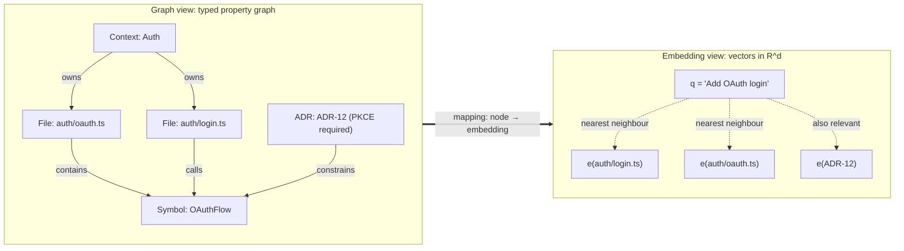
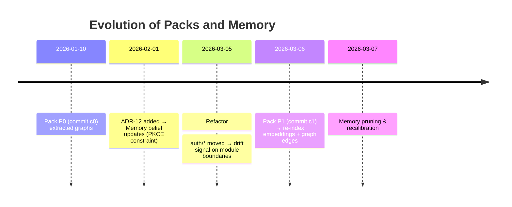
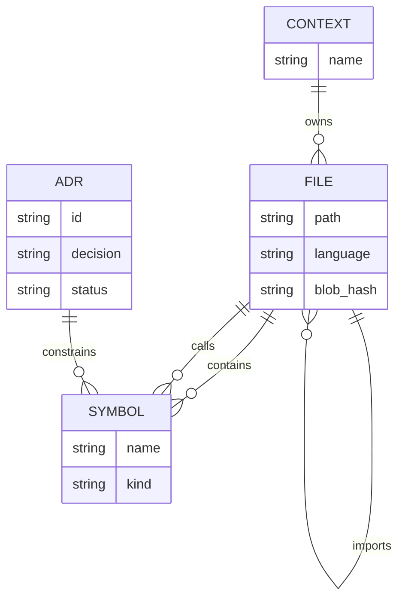

# Mathematics of Structured Perception for RepoLens-Style Agentic Code Understanding

Authority: Supporting
Lifecycle: Reference

> Background research written in reply to a maintainer’s research prompt, kept as reference material. Where it says “your prompt”, that means the maintainer’s prompt. The export carried inline citation markers that pointed into the research tool’s own session and can’t be resolved outside it, so they were removed. Where the text doesn’t name a source itself, such as “a 2024 survey” or “recent work”, treat the claim as unverified.

## Executive summary

“Structured perception” for agentic code understanding can be made mathematically precise as a *layered representation-and-inference stack*:

1. **Immutable facts (Packs)** are best modelled as *content-addressed, typed, attributed structures*—most naturally a **typed property graph** or **RDF-style triple store**—that can be incrementally updated using **Merkle-DAG-style hashing** and queried with graph pattern languages. Git’s internal design as a content-addressable store is a strong precedent for treating repo snapshots as immutable, hash-stable objects.  
2. **Mutable interpretations (Memory)** are best modelled as *uncertain, revisable hypotheses* over those facts: probabilistic labels, relations, and constraints (e.g., “this file implements Auth/Billing”; “this ADR implies invariant X”; “this module boundary is soft”). This naturally leads to **probabilistic graphical models (PGMs)**, **factor graphs**, and **probabilistic programming** with explicit **provenance**.  
3. **Relevance/attention** can be formalised as *expected utility of information*: select observations (files, call paths, ADRs, tests) to maximise **information gain** (entropy reduction / mutual information) under resource constraints (latency, token budget).  
4. **Embeddings and geometry** provide a scalable “soft indexing layer” for retrieval and similarity; but they are not sufficient alone because they obscure provenance and fail under alignment shifts. The most robust approach is **hybrid retrieval**: embeddings for candidate generation + graph/probabilistic structure for verification, grounding, and explanation.  
5. **Temporal evolution** (repo drift, changing conventions, superseded ADRs) is naturally expressed via **dynamic graphs**, **graph streams**, and **concept drift detection**; Memory must support *time-indexed beliefs* and *forgetting / revision* policies.  
6. **Decision and planning** for code changes fits neatly into **MDP/POMDP** mathematics with **constrained optimisation** (CMDPs / chance constraints): “change actions” must satisfy invariants derived from Packs+Memory, while still maximising task utility.  
7. **Repo ↔ product structure alignment** can be treated as **graph/schema alignment** (matching nodes/relations across heterogeneous representations) and, at a deeper level, as **structure-preserving mappings** (homomorphisms / functors) that preserve the meaning of boundaries and invariants across views.  

**Unspecified assumptions.** Your prompt does not specify repo scale, latency constraints, update frequency, or interaction mode. Those matter materially. Throughout, assume these are *unspecified* and present options: (a) small/medium repo with interactive latency (<1–2 s); (b) large mono-repo with batch indexing and interactive retrieval; (c) continuously changing repo with streaming updates and drift detection.

## Formal primitives for structure

This section formalises the “objects of perception” and the algebra you can do on them.

### Graphs, trees, DAGs, and hypergraphs

**Directed graph.** A directed graph is \(G=(V,E)\) with \(E\subseteq V\times V\). Repo structure primitives (imports, calls, “contains”) naturally form directed graphs; file trees are rooted trees; dependency graphs are often DAG-like but can contain cycles.

**Tree / DAG.** A rooted tree is a connected acyclic graph with a distinguished root. A DAG is a directed acyclic graph. Trees/DAGs are computationally friendly: topological order exists for DAGs; many passes are linear-time \(\mathcal{O}(|V|+|E|)\) for adjacency-list representation.

**Hypergraph.** A hypergraph generalises edges to connect *sets* of vertices: \(H=(V,\mathcal{E})\) with \(\mathcal{E}\subseteq \mathcal{P}(V)\) (often \(|e|\ge 2\)). Hypergraphs model “higher-order” relationships (e.g., an ADR connecting multiple modules/files; a design trade-off touching several components). Recent formalisms explicitly combine high-order relations and time/attributes (stream hypergraphs).  

**Typical algorithms.** BFS/DFS (reachability), shortest paths, SCCs, dominators; hypergraph algorithms often use incidence representations, reductions, or specialised hypergraph learning.  

**Complexity notes.** Many global pattern tasks become hard quickly: subgraph matching and maximum common subgraph variants are NP-complete/NP-hard in general, illustrating why “exact alignment” between rich repo/product structures must be approximated or constrained.  

**RepoLens mapping.**  
Packs: store *observed* edges (import graph, call graph, file tree, ADR references) as immutable hyperedges/edges.  
Memory: store *interpretations* over these edges (e.g., “these are the three modules jointly implicated by ADR-12”) possibly as hyperedges with confidence.

### Typed and attributed graphs, property graphs, and ontologies

“Structured perception” usually needs **types** (File, Symbol, ADR, Context) and **attributes** (path, language, owner, timestamp, risk).

**Typed/attributed graph.** One common formalisation is a graph with typing function \(\tau:V\to T\) and attribute function \(\alpha:V\cup E\to \mathcal{A}\) (records/dictionaries).

**Property graph.** A recent formal definition models a property graph as a tuple \(G=(N,E,\rho,\lambda,\pi)\) where \(\rho:E\to (N\times N)\) gives endpoints, \(\lambda\) assigns labels, and \(\pi\) assigns a record of properties.  
This is a natural fit for repo artefacts (nodes) and relations (edges) with metadata.

**RDF graphs and ontologies.** RDF formalises knowledge as sets of triples \((s,p,o)\) (subject–predicate–object), i.e., an RDF graph.  
OWL provides a formal ontology language with a normative abstract structure for classes/properties/individuals to support machine reasoning.  

**Strengths/weaknesses.**  
Property graphs are pragmatic for mixed repo/product nodes and for operational queries. RDF/OWL is stronger for explicit semantics and interoperability, but reasoning can be expensive in the worst case and often requires careful profile choices.  

**RepoLens mapping.**  
Packs: a canonical “repo fact graph” (property graph or RDF named graphs).  
Memory: derived semantic assertions (e.g., “AuthContext depends_on BillingContext”) with explicit provenance links.

### Lattices and concept analysis

A lattice is a partially ordered set \((L,\le)\) where every pair has a join (\(\vee\)) and meet (\(\wedge\)). Lattices become useful when you want *structured summarisation* of “shared attributes”.

**Formal Concept Analysis (FCA).** FCA builds a **concept lattice** from a binary relation between objects and attributes, producing a hierarchy of concepts (extent/intension). Surveys and applied work emphasise FCA as a lattice-theoretic knowledge representation and discovery tool.  

**Why it matters here.** In repo/product perception, FCA can cluster files/modules/features by shared properties (dependencies, tags, ADR references), producing human-steerable structure that is *explainable by construction* (concepts correspond to explicit attribute sets).  

**Complexity.** Constructing full concept lattices can be expensive in the worst case (potentially exponential in attributes), so in practice you use incremental/approximate/distributed FCA variants for scale.  

**RepoLens mapping.**  
Packs: capture the object–attribute incidence (file has dependency X, mentions token Y).  
Memory: maintain abstracted concepts (“these 17 files share the OAuth+PKCE attribute set”) as mutable summaries.

### Category-theoretic views and “structure-preserving” mappings

Category theory becomes relevant when you want to treat “structures” and “translations between structures” as *first-class*.

**Core primitive.** A category \(\mathcal{C}\) has objects, morphisms \(f:A\to B\), identity morphisms, and associative composition. A functor \(F:\mathcal{C}\to\mathcal{D}\) maps objects/morphisms while preserving identities and composition.

**Why it matters for RepoLens.** The repo graph, the product/domain model, and the decision/ADR structure are often *different schemas*. Category-theoretic approaches model schemas and data transformations as structure-preserving mappings; NIST explicitly discusses categorical approaches to data and semantic modelling in ontologies and databases.  
Applied category theory texts and research treat **data migration** as functorial (data as functors, transformations as Kan lifts/adjunctions).  

**RepoLens mapping.**  
Packs: store “objects” and “arrows” (facts and relations) with stable identities.  
Memory: store candidate functors/correspondences (“this domain concept maps to these code modules”) with confidence and revision history.

## Probabilistic models, uncertainty, and provenance

Repo structure is never fully observed (partial reads, stale snapshots, ambiguous naming), and product structure is interpretive. “Structured perception” therefore implies *uncertainty* and *traceability*.

### Bayesian networks, factor graphs, CRFs

**Bayesian network (BN).** A BN is a DAG encoding conditional independences with factorisation:
\[
p(x_1,\dots,x_n)=\prod_{i=1}^n p(x_i\mid \mathrm{pa}(x_i)).
\]
This is standard in probabilistic graphical models.  

**Factor graph.** A factor graph is bipartite (variable nodes + factor nodes) representing:
\[
p(x)\propto \prod_{a} f_a(x_a),
\]
and supports message passing (sum–product) for marginal inference; the tutorial exposition is canonical.  

**CRF (Conditional Random Field).** CRFs model conditional distributions over structured outputs (e.g., label sequences / labelings of graph nodes) and are widely used when you need discriminative structured prediction.  

**Complexity.** Exact inference is tractable for trees (or low treewidth), but becomes intractable in general graphs, motivating approximate inference (loopy belief propagation, variational inference, MCMC). Standard references emphasise this tractability boundary.  

**RepoLens mapping.**  
Packs: observed variables (“file A imports B”, “function f calls g”) are deterministic facts.  
Memory: latent variables (“module assignment”, “invariant holds”, “ADR implies constraint”) with posterior probabilities.

### Probabilistic programming and programmable inference

Probabilistic programming languages (PPLs) treat models as code and inference as computation.

- The **Stan** reference manual defines Stan as a language for coding probabilistic models and performing inference and posterior analysis.  
- **Pyro** describes probabilistic programs as standard Python programs, with stochastic variational inference turning probabilistic computation into optimisation solved with stochastic gradient descent.  
- **Gen** positions itself as programmable inference and hybrid algorithms combining neural nets and Monte Carlo / variational methods.  

**Why PPLs matter for RepoLens.** They give you a way to write:  
- *Generative models of code structure* (e.g., how naming conventions generate module boundaries),  
- *Observation models* (tool outputs, partial file reads), and  
- *Inference procedures* that can be tuned to latency constraints (SVI for speed, MCMC for fidelity).  

### Uncertainty quantification and calibration

For an agent, what matters is not just \(p(\cdot)\) but whether its probabilities are *meaningful* (calibrated) and whether uncertainty sources are understood.

Recent surveys propose taxonomies for uncertainty quantification in deep learning (sources of uncertainty; methods; pros/cons).  
Calibration work continues to refine how Expected Calibration Error (ECE) is measured/interpreted.  

**RepoLens mapping.** Memory should carry calibrated confidence on interpretive claims (“90% confidence this ADR implies invariant X”), and those confidences should be testable against outcomes (tests passing, code review acceptance).

### Provenance as first-class mathematics

To prevent “belief soup”, RepoLens needs provenance.

The **PROV-DM** model defines provenance in terms of entities, activities, and agents, explicitly to support assessment of quality/reliability/trustworthiness.  

In RepoLens terms:
- Packs can store provenance for facts (“derived from file hash H at commit C”, “extracted by parser version v”).  
- Memory can store provenance for interpretations (“hypothesis generated by heuristic”, “validated by test run”, “overridden by ADR”).  

This yields a clean separation: facts are immutable but their provenance graph evolves by adding new derivations; interpretations are mutable and must remain explainable by provenance links.  

## Information theory for relevance and attention, plus embedding geometry

### Information-theoretic measures

**Entropy.** For a discrete variable \(X\) with pmf \(p(x)\):
\[
H(X)=-\sum_x p(x)\log p(x).
\]
Standard definitions and properties appear in information theory references.  

**Mutual information.**
\[
I(X;Y)=H(X)-H(X\mid Y)=\sum_{x,y}p(x,y)\log\frac{p(x,y)}{p(x)p(y)}.
\]

**KL divergence.**
\[
D_{\mathrm{KL}}(p\|q)=\sum_x p(x)\log\frac{p(x)}{q(x)}.
\]

**Surprisal (information content).** For an event \(x\):
\[
S(x)=-\log p(x).
\]
This is a standard information-theoretic notion used widely in language modelling and beyond.  

### How information theory maps to agentic repo perception

Structured perception implies the agent chooses what to look at next (files, symbols, ADRs). That can be formalised as **active information acquisition**:

- Let \(\Theta\) be a latent “true product structure” variable (in Memory).  
- Let \(O_a\) be the observation produced by action \(a\) (e.g., open file, run tests, inspect ADR).  
- Choose \(a\) to maximise expected information gain:
\[
a^\*=\arg\max_a \mathbb{E}\big[ I(\Theta; O_a)\big] - \lambda \cdot \mathrm{cost}(a).
\]
The entropy/mutual-information identities above supply the algebra for “relevance” as expected uncertainty reduction.  

**Strengths.** Gives a principled definition of “attention” and integrates naturally with planning (Section below).  
**Weaknesses.** Requires specifying priors and observation models; can be compute-heavy without approximations.

### Embeddings, metric spaces, and similarity search

Embeddings represent entities (files, symbols, ADRs, nodes) as vectors \(\mathbf{e}\in\mathbb{R}^d\), supporting fast approximate similarity search.

**Cosine similarity.**
\[
\cos(\mathbf{a},\mathbf{b})=\frac{\mathbf{a}\cdot \mathbf{b}}{\|\mathbf{a}\|\|\mathbf{b}\|}.
\]
Many retrieval systems use cosine/dot-product similarity; practical explanations and formulas are standard.  

**Vector indices and complexity.** Modern approximate nearest neighbour methods rely on compressed vectors and non-exhaustive search; the Faiss paper describes these design principles and trade-offs explicitly.  
Graph-based ANN indices like HNSW are a canonical approach.  

**Manifold learning.** Manifold learning seeks lower-dimensional structure of high-dimensional point clouds and is treated in authoritative reviews.  
In RepoLens terms, manifold structure shows up when “code topics” or “domain concepts” occupy low-dimensional subspaces in embedding space—useful for clustering, but fragile under drift.

**Kernel methods.** Kernel methods work with a positive definite kernel \(k(x,y)\) corresponding to an inner product in a (possibly infinite-dimensional) feature space (RKHS). Modern course material foregrounds the mathematical foundation (positive definite kernels, RKHS) and methods like kernel PCA and SVMs.  
Kernel views can model similarity beyond cosine distance (e.g., tree kernels over ASTs), but often scale worse than modern ANN-assisted embedding retrieval.

### Why embeddings must be fused with graphs and provenance

Embeddings are strong at “soft semantic proximity” but weak at:
- strict grounding (“which exact symbol enforces invariant X?”),
- provenance (“why do we believe this mapping?”),
- and guaranteed constraint satisfaction.

Recent work highlights limitations of embedding-based retrieval and the non-metric nature of cosine similarity in some settings, reinforcing that embeddings need structural companions.  

A robust RepoLens posture is therefore: **embeddings for candidate generation; structured graphs + PGMs for verification and explanation**.

### Visual: graph view versus embedding view

## Temporal and evolutionary models

RepoLens-style perception is not static: graphs evolve, conventions drift, and some “facts” are only true for a window (e.g., after a refactor).

### Markov models, HMMs, and dynamic graphs

**Markov chain.** A Markov process satisfies \(P(X_{t+1}\mid X_{0:t})=P(X_{t+1}\mid X_t)\). This is a baseline for modelling evolving states (e.g., file role transitions).

**Hidden Markov Model (HMM).** HMMs model hidden states with observed emissions; in structured perception, “true module role” is hidden while observations are noisy signals (imports, naming, tests).

**Dynamic graphs.** Dynamic GNN surveys formalise settings where topology and attributes change, and categorise techniques by how temporal information is incorporated.  
For higher-order/time-rich structure, Attributed Stream Hypergraphs unify high-order interactions, node attributes, and time.  

### Online learning and concept drift

“Concept drift” captures distributional changes over time, crucial for monitoring and adaptation. A 2024 survey provides precise mathematical definitions and a taxonomy for unsupervised drift detection, with emphasis on localisation/explanation—relevant to repos where labelling is sparse.  

**RepoLens mapping.**  
- Packs: time-indexed immutable snapshots (commit → Pack).  
- Memory: beliefs \(p_t(\cdot)\) that evolve; drift detectors trigger re-evaluation (“module boundary changed; re-learn mapping weights”).

### Lehman-style evolution as a formal constraint on Memory

Lehman’s classic “laws” argue that real-world (“E-type”) software must continuously adapt and that complexity increases unless controlled; while the original formulations are older, the key mathematical lesson for RepoLens is: Memory must support *continuous revision* and *anti-complexity pressure* (regularisation, pruning, summarisation) or it will degrade. A modern mathematical analogue is concept drift + regularised online updates.  

## Decision and planning mathematics, alignment, and hybrid neuro-symbolic architectures

This section ties “structured perception” to *action*: what does the agent do with structure?

### MDPs, POMDPs, and constrained optimisation

**MDP.** An MDP is \((S,A,P,R,\gamma)\) with states, actions, transition kernel \(P(s'\mid s,a)\), reward \(R(s,a)\), discount \(\gamma\). The objective is:
\[
\max_\pi \mathbb{E}\left[\sum_{t\ge 0}\gamma^t R(s_t,a_t)\right].
\]

**POMDP.** In partially observable domains, the agent maintains a belief state \(b(s)\). The classic POMDP reference defines belief update and notes that the optimal policy can be seen as a solution over belief space.  

**Why RepoLens is naturally POMDP-like.** The agent rarely observes the full repo/product state; it queries tools, reads subsets of files, and gets noisy signals. Belief-state planning captures “look before you leap”.

**CMDPs / safe RL.** Safe/constrained decision-making is formalised as Constrained MDPs (CMDPs) and related formulations; recent surveys review CMDP definitions, constrained optimisation techniques, and safe RL constraint representations.  

A canonical constrained objective:
\[
\max_\pi \ \mathbb{E}_\pi\!\left[\sum_t \gamma^t r_t\right]
\quad \text{s.t.}\quad
\mathbb{E}_\pi\!\left[\sum_t \gamma^t c_t^{(k)}\right]\le \beta_k,\ \forall k.
\]
Lagrangian relaxation yields a “soft-constraint” view:
\[
\max_\pi \min_{\lambda\ge 0}\ \mathbb{E}_\pi\!\left[\sum_t \gamma^t \left(r_t - \sum_k \lambda_k c_t^{(k)}\right)\right] + \sum_k \lambda_k \beta_k.
\]
Safe RL surveys and CMDP-focused work emphasise these formulations and the diversity of constraint representations.  

**RepoLens mapping.**  
- Packs provide *hard, checkable* cost functions (failing tests, violating static checks, breaking API contracts).  
- Memory provides *soft, interpretive* constraints (architectural intent, ADR conventions) with uncertainty—ideal for “soft penalties” unless validated as hard invariants.

### Representation alignment between repo structure and product structure

Alignment is the mathematical heart of “repo ↔ product structure”.

**Graph alignment / network alignment.** Network alignment maps corresponding nodes across graphs; a 2024 survey proposes taxonomies and summarises approaches and applications.  

**Knowledge graph entity alignment.** Entity alignment matches entities across KGs; a 2024 survey focuses on representation-learning-based EA methods and challenges.  

**Schema matching.** Recent work studies schema matching using language models and contrast it with labelled-data-heavy approaches, highlighting practical constraints.  

**Complexity boundary.** Exact graph matching and maximum common subgraph problems are computationally hard (NP-complete/NP-hard), motivating approximate, heuristic, or constrained matchers.  

**Category-theoretic alignment.** Category-theoretic approaches treat transformations as structure-preserving mappings and can unify relational/XML/property-graph models (recent work explicitly takes this lens).  

**RepoLens mapping.**  
- Packs define *the source graphs* (repo facts) and perhaps some “declared product artefacts” (ADRs, domain maps).  
- Memory stores correspondences (matchings/functors) and revises them as evidence changes.

### Hybrid architectures: symbolic + neural + probabilistic

Hybrid (“neuro-symbolic”) approaches aim to combine learned representations with explicit symbolic structure; recent surveys review methods, motivations, and trustworthiness angles.  

In RepoLens terms, a fruitful hybrid pattern is:

- **Symbolic substrate:** typed graph + provenance (Packs).  
- **Neural layer:** embeddings for nodes/edges and attention over neighbourhoods; graph transformers are a prominent class and have dedicated surveys.  
- **Probabilistic layer:** uncertainty over interpretations and constraints (Memory), implementable in PPLs.  

A practical mental model is “RAG over structured memory”: retrieve candidates via embeddings, then *re-rank / verify* using graph predicates, provenance checks, and probabilistic inference.

## Practical algorithms, data structures, and evaluation metrics

### Algorithms and data structures

**Content-addressing and Merkle DAGs.**  
Git describes itself as a content-addressable store, where storing content yields a key (hash) used for retrieval.  
This principle generalises to Merkle DAGs (content-addressed nodes with hash references), enabling incremental updates and integrity checks.  

**Vector indices.**  
Faiss explicitly frames vector search as trading off constraints using vector compression and non-exhaustive search, and documents trillion-scale indexing patterns.  
Graph-based ANN indices (e.g., HNSW) are widely used; HNSW is a canonical method.  

**Sparse matrix algebra for graphs.**  
GraphBLAS-style approaches treat graph computations as sparse linear algebra; the GraphBLAS implementation paper explains that many graph algorithms correspond to sparse matrix operations over semirings.  

**Property-graph stores and query languages.**  
Formal work defines the property graph model precisely (useful for a “Packs as graph store” foundation).  
The openCypher ecosystem positions itself as a specification for querying property graphs and notes standardisation directions.  

**RAG mathematics.**  
Recent surveys systematise retrieval-augmented generation (RAG): retriever/generator modularity, robustness issues, and evaluation concerns.  
RepoLens “structured perception” is essentially “RAG + structure”: retrieval is not only text chunks but graph neighbourhoods, provenance chains, and constraint-relevant artefacts.

### Metrics and evaluation

A RepoLens-style system needs to evaluate *both retrieval* and *belief quality*.

**Retrieval and mapping quality.**
- Precision/recall/F1 for retrieved items and for alignment edges (matches).  
- For alignment tasks, network alignment and KG entity alignment surveys discuss benchmarking and methodological families.  

**Uncertainty quality.**
- Calibration metrics such as ECE are widely used; newer work studies calibration error measurement and interpretation.  
- Proper scoring rules (log score, Brier score) evaluate probabilistic forecasts; classic scoring-rule work formalises strict propriety and the relationship between sharpness and calibration.  

**Provenance and fidelity.**
- Provenance completeness / traceability can be formalised via PROV graphs: every interpretive claim in Memory should have at least one provenance path to Pack facts or user assertions.  

**Causal / intervention-style tests.**
A pragmatic “causal” evaluation is to intervene on structure (e.g., remove an ADR, rename a module, delete a dependency edge) and test whether beliefs and plans change appropriately—an operational analogue of invariance and counterfactual reasoning.

### Comparative table of candidate representations

Qualitative ratings assume: large repo, interactive use, need for provenance and grounding.

| Representation | Expressivity | Scalability | Interpretability | Amenable to learning | Provenance support | Grounding to code |
|---|---|---|---|---|---|---|
| File tree / DAGs (imports, calls) | Medium | High | High | Medium | Medium | High |
| Typed property graph \( (N,E,\rho,\lambda,\pi) \) | High | High (with indexing) | Medium–High | High | High (edge-level) | High |
| RDF triples / named graphs | High | High | Medium | Medium | High | High |
| OWL ontology layer | Very high (semantics) | Medium (reasoning costs) | Medium | Medium | Medium–High | Medium |
| Hypergraph / stream-hypergraph | High (higher-order) | Medium | Medium | Medium | Medium | Medium–High |
| Factor graph / PGM overlay | High (uncertainty) | Medium | Medium | Medium | Medium | Medium |
| Vector embeddings + ANN index | Medium (implicit) | Very high | Low–Medium | Very high | Low | Medium |
| Sparse-matrix (GraphBLAS) view | Medium | Very high | Medium | Medium | Medium | Medium |
| Category-theoretic schema + functors | High (mapping semantics) | Medium | Medium–High (for experts) | Medium | Medium | Medium |

A key observation: **no single representation dominates**. The most robust design is a *composite*: property graph (facts) + provenance + embeddings + probabilistic overlays + temporal indexing, with alignment machinery between repo and product schemas.  

## Worked example: a combined mathematical object with inference and planning

This is intentionally small and didactic.

### Toy repo and product artefacts

Assume a repo contains:

- Files:  
  \(f_1=\) `auth/login.ts`  
  \(f_2=\) `auth/oauth.ts`  
  \(f_3=\) `billing/invoice.ts`

- Symbols:  
  \(s_1=\) `OAuthFlow`, \(s_2=\) `PasswordLogin`, \(s_3=\) `InvoiceService`

- Product structure artefacts:  
  ADR \(a_1=\) “PKCE required for OAuth”  
  Domain contexts \(c_1=\) Auth, \(c_2=\) Billing

### Combined representation: a typed property graph + probabilistic overlay

**Packs (immutable facts).** Represent as a property graph \(G_P=(N,E,\rho,\lambda,\pi)\).  

Nodes \(N\) include \(f_i,s_j,a_1,c_k\).  
Labels \(\lambda\) include `File`, `Symbol`, `ADR`, `Context`.  
Properties \(\pi\) include path, language, commit hash, timestamps.

Edges \(E\) include:
- `contains(f2, s1)`, `contains(f1, s2)`, `contains(f3, s3)`  
- `calls(f1, s1)` (login uses OAuthFlow)  
- `belongs_to(f1, c1)`, `belongs_to(f2, c1)`, `belongs_to(f3, c2)` (if declared; otherwise inferred)  
- `constrains(a1, s1)` (ADR references OAuthFlow)

Packs are content-addressed: every node/edge bundle is keyed by its content hash (Git-style).  

**Memory (mutable interpretations).** Introduce random variables:
- \(Z_i \in \{c_1,c_2\}\): context assignment for file \(f_i\)  
- \(K \in \{0,1\}\): whether PKCE is a *hard invariant* for OAuth changes

Initial beliefs (priors):
- \(P(Z_1=c_1)=0.8\), \(P(Z_2=c_1)=0.9\), \(P(Z_3=c_2)=0.95\)  
- \(P(K=1)=0.6\)

These are stored in Memory with provenance pointers to evidence edges (imports, folder path, ADR links).  

### Inference step: relevance scoring for a query

Query: \(q=\) “Add OAuth login”.

**Embedding candidate generation.** Compute embeddings \(\mathbf{e}(x)\) for each node \(x\) and query vector \(\mathbf{e}(q)\). Use cosine similarity:
\[
\mathrm{sim}(q,x)=\frac{\mathbf{e}(q)\cdot \mathbf{e}(x)}{\|\mathbf{e}(q)\|\|\mathbf{e}(x)\|}.
\]

Suppose ANN retrieval returns top candidates: \(f_2, f_1, a_1\) (oauth file, login file, ADR). This is standard embedding retrieval behaviour.  

**Graph-based re-ranking / grounding.** Define a structural score:
\[
\mathrm{graphscore}(x)=\exp(-d_G(x, s_1)),
\]
where \(d_G\) is shortest-path distance in the typed graph to the key symbol \(s_1=\) OAuthFlow (identified by either lexical match or embedding/graph lookup).

- \(d_G(f_2,s_1)=1\) via `contains`  
- \(d_G(f_1,s_1)=1\) via `calls`  
- \(d_G(a_1,s_1)=1\) via `constrains`

Now combine:
\[
\mathrm{score}(x)=\alpha\,\mathrm{sim}(q,x) + (1-\alpha)\,\mathrm{graphscore}(x).
\]
This “hybrid retrieval” pattern aligns with modern RAG survey taxonomies: retrieval quality and grounding fidelity require joint modelling of retrieval and reasoning rather than embeddings alone.  

### Belief update: new ADR evidence changes the invariant belief

Assume a new ADR \(a_2\) is added: “All OAuth flows must use PKCE; non-PKCE flows are rejected in security review.” This is inserted into Packs as a new immutable node and edges referencing OAuthFlow. Git-style addressing supports incremental updates.  

Model the ADR as evidence \(E\) about \(K\). Suppose:
- Likelihood \(P(E\mid K=1)=0.9\) (if PKCE is truly hard, ADR likely exists)  
- Likelihood \(P(E\mid K=0)=0.2\)

Bayes update:
\[
P(K=1\mid E)=\frac{P(E\mid K=1)P(K=1)}{P(E\mid K=1)P(K=1) + P(E\mid K=0)P(K=0)}.
\]
Using \(P(K=1)=0.6\):
\[
P(K=1\mid E)=\frac{0.9\cdot0.6}{0.9\cdot0.6+0.2\cdot0.4}
=\frac{0.54}{0.54+0.08}\approx 0.871.
\]
This is a concrete illustration of “Memory as probabilistic interpretation overlay” and is exactly the kind of update logic supported by PGMs / factor graphs / PPLs.  

Memory records not only the new posterior but also provenance: \(a_2\) caused the update, with a PROV relationship “wasDerivedFrom” / “wasGeneratedBy” style links.  

### Planning constraint enforcement: from beliefs to guarded actions

Suppose the agent considers an action \(a\): “Modify `auth/oauth.ts` to add a new OAuth provider flow”.

Model this as a CMDP-style step where reward is task progress and cost encodes safety constraints. Safe RL surveys discuss CMDP-based formulations and constraint diversity.  

Define cost \(c(a)=\mathbb{1}\{\text{PKCE not enforced}\}\). If the agent’s belief \(P(K=1)\) is high (0.871), it can impose a *soft or hard guardrail*:

- **Hard guardrail mode (if \(P(K=1)>\tau\), say \(\tau=0.85\))**: prohibit actions whose static analysis/test simulation predicts PKCE violation.  
- **Soft guardrail mode**: penalise expected constraint violation:
\[
\mathbb{E}[c(a)] \approx P(K=1)\cdot P(\text{violate}\mid K=1,a).
\]

This is the mathematical bridge between “seeing product structure” and “constraining future code-generation behaviour”: constraints are not sacred by default; they are beliefs with provenance that become hard only when sufficiently supported.  

## Appendix-style mermaid: entity relationships for the toy combined object

